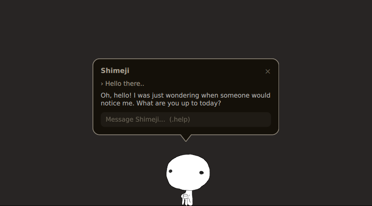

# Mascot - Shimeji desktop mascots for Wayland that you can talk to

Mascot puts [Shimeji](https://kilkakon.com/shimeji/)-style characters on your Wayland desktop. They walk
along the bottom of the screen, sit down and can be picked up and thrown. Tap one and a speech bubble
opens next to it: type a message and the answer from a language model is streamed into the bubble,
while the mascot sits still and talks. The answers come from
[aichat](https://github.com/sigoden/aichat), so a local model through Ollama works as well as a hosted one.

Mascot is a fork of [wl_shimeji](https://github.com/CluelessCatBurger/wl_shimeji) by CluelessCatBurger,
licensed under GPL-2.0-or-later like the original. The engine (prototypes, the condition VM, the
Wayland overlay) is theirs; Mascot adds the chat bubble, tap-versus-drag input, a bundled mascot and
the renaming. Source files changed from upstream say so in their header, and the git history shows
exactly what has changed.

<p align="center">
  
</p>

Shimejis on the screenshot (from upstream) by [paccha](https://linktr.ee/paccha_) and [Moneka](https://x.com/Monikaphobia)

## Compositor support

Mascot needs a compositor with **wlr-layer-shell** and **wl_subcompositor**, so GNOME (Mutter) and
Gamescope will not work.

- **Hyprland** is what Mascot is developed and tested on (0.56). It works, with two known quirks:
  a mascot that overlaps the right or bottom edge of the screen is squashed instead of clipped
  ([hyprwm/Hyprland#10515](https://github.com/hyprwm/Hyprland/issues/10515)), and Mascot works around
  a Hyprland crash when the bubble closes while the pointer is over a mascot.
- **KDE Plasma, Sway and other wlroots compositors** are supported by upstream but have not been
  tested with Mascot's changes.

## Quick start

```sh
git clone --recurse-submodules https://github.com/Xedoc91/mascot.git
cd mascot
make -j$(nproc)
make PREFIX=$HOME/.local install
mascot summon Shimeji     # starts the daemon and the chat bubble
mascot stop               # stops both again
```

Mascot ships with the original Shimeji. For the chat bubble you also need Quickshell and a
configured aichat (see [Chat bubble](#chat-bubble)).

# Requirements

## Build requirements

- libwayland-client:
  - Arch: `pacman -S wayland`
  - Debian: `apt-get install libwayland-dev libwayland-bin`
  - Fedora: `dnf install libwayland-client wayland-devel`
- wayland-protocols:
  - Arch: `pacman -S wayland-protocols`
  - Debian: ??? You can manually clone wayland-protocols and then specify it path by setting WAYLAND_PROTOCOLS_DIR to wayland-protocols' absolute path
  - Fedora: `dnf install wayland-protocols-devel`
- libarchive:
  - Arch: `pacman -S libarchive`
  - Debian: `apt-get install libarchive-dev`
  - Fedora: `dnf install libarchive-devel`
- uthash:
  - Arch: `pacman -S uthash`
  - Debian: `apt-get install libuthash-dev`
  - Fedora: `dnf install uthash-devel`

## Runtime requirements

Your compositor should *at least* support xdg-shell, wlr-layer-shell protocols, and provide wl_subcompositor interface.

## mascot (CLI) requirements

- python-pillow
  - Arch: `pacman -S python-pillow`
  - Fedora: `dnf install python3-pillow`
- python >= 3.10

# Installing

## Packages

There are no packages for Mascot yet; build it from source (below).
The upstream project has packages of its own, which install wl_shimeji, not Mascot:
[wl_shimeji-git](https://aur.archlinux.org/packages/wl_shimeji-git) and
[wl_shimeji-plugin-kwinsupport](https://aur.archlinux.org/packages/wl_shimeji-plugin-kwinsupport) on the AUR,
and a Nix flake (see the [upstream README](https://github.com/CluelessCatBurger/wl_shimeji#readme)).

This repository still contains the upstream Nix flake, updated for the new names, but it has not
been built or tested since the fork.

# Building

From a checkout of this repository, with submodules (`git submodule update --init`):

```sh
make -j$(nproc)
sudo make install                    # to /usr/local
make PREFIX=$HOME/.local install     # or just for you, without sudo
```

`$(PREFIX)/bin` must be in your `PATH`, since `mascot` starts `mascotd` from there.
`make uninstall` removes the files again (pass the same `PREFIX`/`DESTDIR`).

# Plugins

You can also build plugins (everything in src/plugins subdirectories). They come from upstream
and only work on KDE; they build with Mascot but have not been tested with it.
Plugins are optional, but can provide such features as:

- Interactions with other applications' windows
- Get global mouse position

Currently mascots can't move windows as it is not supported by mascot.

Currently we have following plugins:

- src/plugins/kwinsupport - KDE integration using it's scripting API

## Dependencies for plugins

- KwinSupport:
  - libsystemd (for dbus):
    - Arch: `pacman -S libsystemd`
    - Debian: `apt-get install libsystemd-dev`
    - Fedora: `dnf install systemd-devel`
  - uthash:
    - Arch: `pacman -S uthash`
    - Debian: `apt-get install libuthash-dev`
    - Fedora: `dnf install uthash-devel`
  - libmascot-plugins (supplied by mascot)
  - mascot should run with XDG_CURRENT_DESKTOP set to "KDE" and org.kde.KWin must be present on session bus

## Building plugins

```sh
make build-plugins -j$(nproc)
```

## Installing plugins

```sh
make install-plugins
```

# How to use

## Converting to mascot format

First, you need to find some Shimeji-ee mascots. They are usually distributed as zip archives. You can find them on the internet.
When you got shimejis of your choice, you need to convert them to the mascot format.

```sh
mascot convert /path/to/shimeji-ee.zip -O /some/output/directory
```

It will try to read the zip archive and will ask you to select which mascots you want to convert:

```bash
$ mascot convert "The Neuroling Collection v0.7.zip" -O output/
Prototypes available for conversion:
1. Weuron
2. Vedaling
3. Tuteling Cursor
4. Tuteling
5. Neuron
6. Neuroling
7. Eviling
8. Evil Neuroling
9. Broken Neuron

Enter prototypes index or name to convert (can be comma-separated or A to convert all)
>
```

When you selected mascot types that you need, mascot will convert them to the mascot format and will save them to the output directory with names like
`Shimeji.{mascot_name}.wlshm`. Converting does not start Mascot.

# Importing .wlshm prototypes

After you successfully converted your mascots, you can import them to the mascot format using the following command:

```sh
mascot prototypes import /path/to/Shimeji.{first_name}.wlshm /path/to/Shimeji.{second_name}.wlshm ...
```

If prototype already exists, mascot will skip it unless -f is used.

# Listing available prototypes

You can list all available mascot prototypes using the following command:

```sh
mascot prototypes list
```

Mascot ships with the original Shimeji by Yuki Yamada (Group Finity), installed to
`$(PREFIX)/share/mascot/prototypes/`. Prototypes you import yourself go to
`~/.local/share/mascot/shimejis/` and take precedence over a bundled one with the same name.

# Summoning mascots

To summon mascot, you need to know mascot's name, which you can get by using `mascot prototypes list` command. When you found mascot of your choice, you can summon using `mascot summon {name}` command, where `{name}` is the name of the mascot you want to summon.

For example, if you want to summon a mascot named Neuron, you can use the following command:

```sh
mascot summon Neuron
```

If you want to summon mascot at specific location, you can use --select flag or pass your coordinates as -x -y or -position x,y

## Dismissing mascots

To dismiss mascot, you can use `mascot dismiss` command.
mascot will ask you to click on target mascot.
Also we have flags that can be used to dismiss multiple mascots at once.
Use `mascot dismiss --help` to see all available flags.

## Setting mascots behaviors

You can replace mascot's behavior by using `mascot set-behavior {behavior}` command, where `{behavior}` is the name of the behavior you want to set. mascot will ask you to click on target mascot.

You can get all available behaviors by using `mascot prototypes info {prototype_name}` command, where `{prototype_name}` is the name of the mascot prototype you want to get information about.

# Exporting prototypes

You can export mascot prototype by using `mascot prototypes export` command. It will produce .wlshm file that you can then share with others.

```sh
mascot prototypes export -i {prototype_name} -o {output_file}
```

## Stopping application

You can stop the application by using `mascot stop` command.

## Configuration

You can configure some options of overlay by using `mascot config` command.

```sh
mascot config set "option_name" "value"
```

You also can get option value by using `get` action:

```sh
mascot config get "option_name"
```

Or values of all options by using `list` action:

```sh
mascot config list
```

Config file is usually located at `~/.local/share/mascot/mascotd.conf`

# Chat bubble

Left-click (tap) a mascot and a speech bubble opens next to it. Type a message, press Enter, and
the answer from a language model is streamed into the bubble. The mascot sits still while the
bubble is open.

The bubble is a separate [Quickshell](https://quickshell.org/) project in `ui/`; `make install`
puts it in `$(PREFIX)/share/mascot/ui/`. The answers come from [aichat](https://github.com/sigoden/aichat),
so any model aichat supports works, including local ones through Ollama.

## Requirements

- Quickshell (`pacman -S quickshell`)
- aichat (`pacman -S aichat`), configured with at least one model
- Optional: pywal (`pacman -S python-pywal`) for colours that follow your theme (see [Colours](#colours))

## Starting and stopping

You do not start the bubble yourself: `mascotd` starts it (`qs -p $(PREFIX)/share/mascot/ui`) and
stops it again, so it runs exactly as long as Mascot does.

```sh
mascot summon Shimeji   # starts mascotd, which starts the bubble
mascot stop             # stops mascotd and the bubble, including an aichat that is answering
```

Nothing is left running in the background: the bubble runs in its own process group, which mascotd
stops when it exits (also on SIGTERM, or when the last mascot is dismissed). If mascotd is killed
outright, the kernel stops the bubble (`PR_SET_PDEATHSIG`) and the bubble quits when it loses the
daemon.

To run the bubble by hand instead, e.g. while working on `ui/`, set `BUBBLE_ENABLED` to `false` and
start it next to the daemon (not as part of another Quickshell config):

```sh
qs -p /usr/local/share/mascot/ui
```

Started by hand, it reconnects if the daemon is restarted. It uses the daemon's chat socket,
`$XDG_RUNTIME_DIR/mascotd-chat.sock`, or `MASCOT_CHAT_SOCKET`. The daemon names the chat socket
after its IPC socket, so `-s /run/user/1000/foo.sock` gives `foo-chat.sock`.

## Using it

- **Tap** a mascot to open the bubble. Dragging a mascot does not open it, and dragging the mascot
  away closes it.
- The bubble takes the keyboard when it opens, so you can type straight away. Click another window
  to type there while the bubble stays open; click the bubble (or tap the mascot) to go back.
- **Enter** sends, **Esc** or **×** closes.

Lines starting with `.` are commands, modelled on aichat's REPL:

| Command | Effect |
|---|---|
| `.help` | List the commands |
| `.info` | Show aichat's settings |
| `.models`, `.roles`, `.sessions` | List them |
| `.model <name>` | Switch model, e.g. `.model openrouter:…` |
| `.role <name>` | Switch to one of your aichat roles instead of Mascot's prompt |
| `.session <name>` | Start or continue a session, which gives the conversation memory |
| `.exit model\|session` | Go back to the default |
| `.exit role` | Leave the role, also the one from `CHAT_ROLE` (until `.role` or a restart) |
| `.mascots` | List the mascots you have installed |
| `.mascot <name>` | Swap this mascot for another one, e.g. `.mascot Black Bunny` |
| `.clear` | Clear the bubble |

The model, role and session apply to every mascot until changed, and reset when `qs` restarts.

`.mascot` replaces the mascot by the bubble with a new one of the given type (any letter case) in the
same spot, facing the same way. The bubble stays open and the conversation carries on with the new
mascot; with Mascot's prompt it answers under its new name from the next message.

## The mascot's personality

Unless you pick a role with `.role` or set `CHAT_ROLE`, every message is sent with Mascot's own system prompt
(aichat's `--prompt`), so the mascot answers in character, briefly and in your language. `{name}` in
the prompt becomes the mascot's name, so Brown Bear answers as Brown Bear. Your aichat roles and
your `cmd_prelude` are left alone; the prompt simply takes their place in the bubble.

The bundled prompt is `$(PREFIX)/share/mascot/ui/prompt.md`. To write your own, put a `prompt.md` in
Mascot's data directory (`~/.local/share/mascot/prompt.md`); it replaces the bundled one, and an
empty file turns the prompt off. The bubble reads it when it starts, so run `mascot stop` after
changing it.

To start with one of your aichat roles instead, set `CHAT_ROLE`, e.g. `mascot config set CHAT_ROLE
Gemma4`. It replaces the prompt from the next tap; `.role` overrides it, and `.exit role` leaves it
until you pick a role again or `qs` restarts.

## Configuration

| Option | Default | Description |
|---|---|---|
| `CHAT_ENABLED` | `true` | `false` closes the bubble and stops taps from opening it; `true` starts it again. Takes effect without a restart. |
| `CHAT_COMMAND` | empty | The command that answers a message. |
| `CHAT_ROLE` | empty | The aichat role the bubble starts with (`-r`); empty means Mascot's prompt. Takes effect from the next tap. |
| `BUBBLE_ENABLED` | `true` | Whether mascotd starts the bubble. Read when mascotd starts. |
| `BUBBLE_COMMAND` | empty | The command mascotd starts the bubble with; empty means `qs -p $(PREFIX)/share/mascot/ui`. |

The message is appended to `CHAT_COMMAND` as an argument, never parsed by the shell, and stdin is
closed. An empty `CHAT_COMMAND` means plain `aichat` with your normal config.

The bubble cannot answer aichat's prompts, so a reply that waits for one (for example to confirm a
tool call) never arrives. If your config uses tools, give the bubble a separate aichat config
without them, e.g. a copy with `function_calling: false` in `~/.config/aichat-bubble/`:

```sh
mascot config set CHAT_COMMAND 'AICHAT_CONFIG_DIR="$HOME/.config/aichat-bubble" aichat'
```

## Blur on Hyprland (optional)

The bubble's layer namespace is `mascot-bubble`. With Hyprland 0.53 or newer:

```
layerrule = blur on, match:namespace mascot-bubble
layerrule = ignore_alpha 0.3, match:namespace mascot-bubble
```

## Colours

The bubble takes its colours from pywal (`~/.cache/wal/colors.json`) when it exists, and follows
the file when it changes. What you type is shown in `color4` (also used for the mascot's name and
the outline), the answer in the foreground colour, and the bubble's own messages and command output
in `color8`. Without pywal it uses built-in dark colours.

# Advanced usage

## Multihead usage

mascot supports multiple screens. However, some features may be disabled by default. Config provides following options:

- ALLOW_THROWING_MULTIHEAD: Allows throwing mascot between screens
- ALLOW_DRAGGING_MULTIHEAD: Allows dragging mascot between screens
- UNIFIED_OUTPUTS: Treats all outputs as one entity

You may want block one of displays from being used by mascot in runtime, so we have `mascot environment close` to disable one of outputs. mascot will ask you to select one of outputs by clicking on it. After this operation, you can't restore display unless you restart mascot or reconnect display to the system.

## Interpolation

mascot supports movement interpolation of mascots. You can enable it by setting INTERPOLATION_FRAMERATE to value that is not equal to 0. Values > 0 used as interpolation frame rate. -1 Picks output's refresh rate as interpolation frame rate. Values under -1 are not allowed.

## Tablets

mascot recognized pentablets as input method, so you can use it as input device. However, currently subsurfaces bugged under KDE when using them with wp-tablet-v2, so you may want to disable that feature by setting TABLETS_ENABLED to false.

## Mapping mouse buttons

You can map mouse button and tablet events (stylus down, stylus up) to different actions. For example you can remap right button to 0x01, so it will act as left button and etc.

## Using systemd socket

mascot can be activated on-demand through systemd socket. To enable it, use `systemctl --user enable --now mascotd.socket`.
This is optional and has not been tested with Mascot's changes; `mascot summon` starts the daemon by itself.

## Running overlay manually

You can start overlay manually by running `mascotd`. It's not recommended and *useless* in case you don't pass -se flag to it or
if you don't pass unix fd using -cfd flag, unless you implementing another frontend for the overlay. If -se or -cfd not specified
overlay will close immediately after start.

Arguments:

- `-s`, `--socket-path`  - path to the overlay socket file.
- `-cd`, `--configuration-root`  - path to the configuration root of the mascot (`~/.local/share/mascot` by default)
- `-cfd`, `--caller-fd` - paired unix socket fd used for communication. If closed and no other clients connected nor no mascots exists, overlay will close.
- `-c`   - config file path.
- `-pl`  - path to the plugins directory.
- `-pr`  - path to the prototypes directory.
- `-se` - summon everyone. If specified, overlay will summon all known mascots upon start.
- `-v`, `--version`  - version of the overlay.
- `--no-tablets` - disable wp_tablet_v2 wayland protocol support. (broken on kwin right now anyway)
- `--no-viewporter` - disable wp_viewporter wayland protocol support. mascot will use wl_surface.set_buffer_scale() instead.
- `--no-fractional-scale` - disable wp_fractional_scale wayland protocol support. Will use wl_output's scale info instead
- `--no-cursor-shape` - disable wp_cursor_shape wayland protocol support. Will disable cursor shapes for different actions.
- `--no-plugins` - disable plugins

# Features

These are upstream's features and measurements ("I" and "my implementation" refer to wl_shimeji's author).

1. Less CPU
    - Because of C and Wayland, I was able to make this program as lightweight as possible.
    - When compared to the original Shimeji, my implementation for same configuration uses in ~20 times less CPU.
    (Tested on AMD Ryzen 9 5900HX, 7 mascots. Original Shimeji used ~19% of one CPU core. My implementation used ~0.9% of one CPU core)
    (Do not trust these numbers, they can be different for your configuration)
2. Less RAM
    - Because of prototypes-based method, mascots use as less memory as possible.
    (Tested on AMD Ryzen 9 5900HX, 7 mascots. Original Shimeji ~880MiB. My implementation used ~56MiB)
    (Do not trust these numbers, they can be different for your configuration)
3. Fast VM-based condition evaluation:
    - I implemented simple virtual machine and bytecode compiler for javascript-like conditions used in the original Shimeji.
    - It's not as fast as native code, but it's faster than the original Shimeji.

## Configuration

On first start, the program will create a configuration file in the config directory.
Currently config file allows to:

- Enable/Disable mascot breeding
- Enable/Disable mascot dragging
- Enable/Disable IE interactions (doesn't make sense without plugins)
- Enable/Disable IE throwing (doesn't make sense without plugins)
- Enable/Disable cursor position tracking (doesn't make sense without plugins)
- Set max number of mascots
- Set IE Throw Policy (doesn't make sense without plugins)

All parameters except max number and IE Throw Policy is booleans.
IE Throw Policy and max number is integers.

I will not explain possible values for IE Throw Policy for now.

# Upstream's notes

The rest of this README is by CluelessCatBurger, the author of wl_shimeji, kept as written.
"I" is them, not the Mascot fork.

## TODO LIST

- [ ] Write documentation for plugins API
- [ ] Add more configuration options

## Notes

- About environment interaction: It will be available only through the plugins. Wayland protocol doesn't allow to interact with windows of other applications,
  and will NEVER allow it. It's a security feature. If you think that it makes Wayland bad, ask yourself a question: Why application even should have access to
  the windows of other applications? Try to find at least 5 apps that need this feature and then come back to me.
- About plugins: It will be .so files that will be loaded at runtime. It can implement any functionality to lookup positions of active window, pointer, etc.
  There is no way to make it portable. For example, you theoretically can use kdotool to get and move windows, but it's will work only under kwin.
- X11 support? No, X11 doesn't provide key features that I need for this project. You can try to implement it. For it to work, you need to implement each and every function from
  src/environment.h
- ~~Windows~~/Macos/FreeBSD/InsertYourOS support? If you will able somehow run Wayland on it or reimplement funcs defined in src/environment.h, then yes. I don't have any plans to do it.
- If you want to help me with this project, beware src/mascot_config_parser.c. I warned you. (No, really, even i don't understand what's going on there.)
- Windows support? After searching for a while, I found that there is a similar mechanism to wl_subcompositor in Windows called "DirectComposition".
  I will not implement it by myself, but if you want to try, you can do it.

## Blabbering section

### What is Shimeji?

Shimeji is a program that creates a little character that wanders around your desktop. It can be customized with different skins and can be set to interact with the desktop environment.

### Why did I start this project?

The original Shimeji is written in Java and very unoptimized. It uses a lot of CPU and memory.
For example, from cold start, in some configurations, setup from 7 mascots can eat up 880MiB of RAM and ~19% of one cpu core (AMD Ryzen 9 5900HX)

I think this is unacceptable for such a simple program.
Moreover, original Shimeji is starting lagging when too many mascots on the screen, and because each mascot is a SEPARATE WINDOW, it slow down entire
compositor, with probaility of crashing it.

Even if we close eyes on the graphics, the original Shimeji uses javascript for the conditions, so it's makes everything even slower.

### How my reimplementation is better?

When I started this project, i started with the idea of making it as fast and as lightweight as possible.
So i started to analyze the original Shimeji and found things that can be definitely improved.
For example, when original Shimeji creates a new mascot, it creates instance of the `Mascot` class. What's wrong with it?
Actually nothing, but if we check how instances of `Mascot` are created, we can see that each instance is holds it's own copy of configuration and all sprites.
This is a big problem, as configuration and sprites are not very small, so it's a waste of memory.

What we can do then to improve it? Answer is simple: Prototypes! Instead of copying configuration and sprites for each mascot, we can create a prototype of the mascot
and then reference it in the actual mascot, maintaining the same functionality, but with less memory usage.

So my entire reimplementation is based on this idea. I'm using prototypes for mascots, and only the necessary data is copied for each mascot.

But what about language and graphics? Why I choose C and Wayland from all the possible options?

#### Wayland

This is quite interesting story. When I started this project, i was very interested in the Wayland protocol and how it works.
But this is not enough to choose it as a base for the project, so why Wayland? The answer is subcompositors.
In Wayland, everything that shown on the screen is a surface with it's role. For example, the window is a surface with a role of `xdg_toplevel`.
But what if we want to make complex window with multiple layers? Usually, we need to rerender everything in region that need to be updated.
It's can be difficult, it is developer's responsibility to handle it, and you should be smarter than me to do it.
But in Wayland, we have a concept of subcompositors. Subcompositor is a method to make composite window from multiple surfaces, and it's compositor's
responsibility to handle how window should be rendered. We will return to this later.

Then, if we return to prototypes, we can also find that wayland from box allows us create buffer only from shared memory, but at the same time, we
can reuse same buffer for multiple surfaces. This is exactly what we need for prototypes! We create our buffer only once, and then we reuse for each mascot when we need to.

Then we can start to implement our shimeji project, and...

Oh. oh no. We forgot about nature of Wayland.
Wayland is protocol with security in mind. It's not like X11, where you can do everything you want with the windows.
So what can we do? Or rather, what can’t we do? We can't position our mascots freely on the screen as we don't have access to the window positions (at all).

So, then what we actually can do?
If we open wayland.app, we can see set of protocols that exists in the Wayland. Not each protocol is implemented in each compositor,
but lets see what it can offer us.

So, wlroots created wlr-layer-shell protocol. This protocol allows us to create overlays on the screen. If we can create fullscreen overlay with no input and fully transparent,
we can guarantee that pixel on the overlay is the same as pixel on the screen, so now we can set position of our mascots freely.
But i don't want to render anything, what then I can do?

Now we can return to the subcompositors. We can use subcompositor functionality to avoid manual rendering of mascots. Instead we create subsurface for each mascot
and then attach it to our overlay. Now we can set position of our mascots freely and we don't need to render anything manually, because we use precreated buffers for each possible sprite.

#### C

Now, when we decided to use Wayland, we need to choose language.
Oh, no language currently (Feb 2024) supports Wayland on same level as C (We need low level access to the Wayland protocol). Guess, I had no choice.
Anyway, it will economize memory and CPU usage, so it's not that bad.
That pretty much sums up why I choose C.

#### Conditions and expressions in configuration files

Original Shimeji includes a feature called "Using JavaScript in places where you should not use JavaScript". I not expert in Shimeji-ee, but i think that
one of the reasons why 7 mascots can eat up 880MiB of RAM. I will not test it, but i decided that i will not include javascript in my project. Even if it means
that i will be required to implement compiler of javascript and my own virtual machine for it.
So now we have our own virtual machine instead of javascript. It was great experience.

<!-- !kryeg14 SchizoUUH ✊ !bwaa -->
